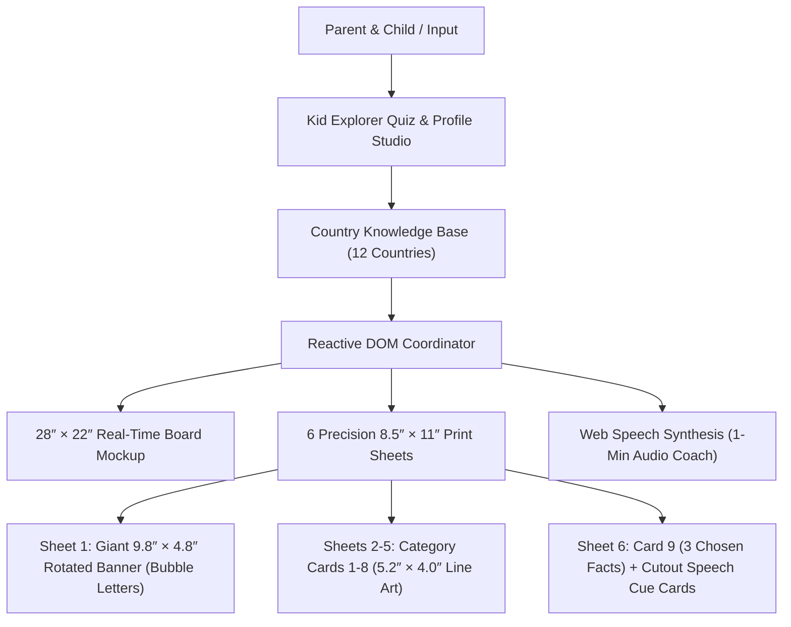

# Kids Country Poster Board Builder: Solving A Critical User Journey

*Transforming stressful, last-minute school culture poster assignments into an autonomous, kid-driven learning adventure using precision print calibration, active discovery quizzes, and speech synthesis.*

---

## 🔍 The Problem Space

### Context
Every autumn, hundreds of thousands of elementary school students (ages 5–8) and their families receive assignment sheets for **Hispanic Heritage Month** and international culture days. The assignment rubric typically requires:
- A standard **28″ Wide × 22″ Tall** tri-fold or flat poster board.
- Up to 9 distinct informational categories (geography, capital, cuisine, traditional dance, national clothing, carnival/art, landmarks, famous historical or cultural heroes, and fun trivia).
- Mandatory visual elements: labels, student name, neat coloring, and oral presentation readiness.
- Household toolchain: A standard black-and-white or desktop inkjet printer printing only on **8.5″ × 11″ letter paper**.

### The Core Friction
1. **The "Parent Takes Over" Trap (Passivity):** Existing school project workflows force parents to spend hours searching Google Images, wrestling with Microsoft Word or PowerPoint margins, and doing all the cutting, formatting, and writing. The 5-year-old child sits passively watching television, learning almost nothing.
2. **The Print Scale Mismatch:** Standard letter paper is 8.5″ × 11″, while poster boards are 28″ × 22″. Without automated calibration, banners end up too small (~7″), cards leave massive blank voids on the board, or images get cut off at page margins.
3. **The Ink & Coloring Problem:** Downloading color photos consumes expensive color ink cartridges and leaves no room for the child to actively color. Conversely, random coloring pages downloaded from the web have inconsistent artistic styles, dark grayscale shading that wastes toner, or inappropriate reading levels.
4. **Presentation Anxiety:** 5-year-olds are asked to present in front of their class without structured, bite-sized speaking scripts calibrated to their vocabulary level.

---

## 🚦 Critical User Journeys (CUJs)

### CUJ 1: Active Kid Learning & Calibration (Parent & Child)
* **Statement**: I want to **generate a rubric-compliant country poster kit on standard 8.5″ × 11″ paper** while avoiding **hours of manual formatting, expensive color ink waste, and doing the work for my child** so that **my child actively learns about their assigned culture, colors every illustration with pride, and satisfies all 9 school rubric criteria.**
* **User Scenario**: *A parent sits down with their 5-year-old kindergartner on a Sunday afternoon. They open the web app, let the child answer fun discovery questions, choose their favorite music hero and 3 wild trivia facts, and hit print. 6 perfectly calibrated sheets emerge from their home printer—including a giant rotated banner with hollow bubble letters and pocket speech cue cards.*

### CUJ 2: Interactive Discovery & Country Exploration (Student)
* **Statement**: I want to **discover which country matches my curiosity through a 4-question explorer quiz** while avoiding **dry, dense encyclopedic reading** so that **I feel like a real explorer and can proudly teach my classmates about my chosen culture.**
* **User Scenario**: *A student at North Beach Elementary who hasn't chosen a country yet takes the interactive visual quiz on an iPad, finds their match with celebratory sound effects and confetti, hears the traditional cheer ("¡Wepa!"), and listens to the computer coach them on their 1-minute class speech.*

---

## 🗺️ The Ideal Flows

### Flow 1: End-to-End Poster Creation & Speech Coaching
1. **Trigger**: Student receives a cultural heritage display assignment with a 28″ × 22″ poster rubric.
2. **Action**: The parent/student visits the web app, types their name (*"Izzy"*), and selects their country (or takes the 4-question discovery quiz).
3. **Automated Response**:
   - The engine instantly customizes the 9-category curriculum.
   - Generates high-contrast, pure black-and-white line-art illustrations (4:3 landscape, 5.2″ × 4.0″) paired with concise, kindergarten-accessible fact columns (2.1″).
   - Generates a giant header banner natively rotated 90° to span 9.8″ × 4.8″ along the 11″ paper length with 84px and 56px hollow bubble letters.
   - Compiles a 1-minute presentation script and provides browser-native text-to-speech practice.
4. **Resolution**: The child colors all illustrations with markers/crayons, cuts along dashed outer guide lines, pastes them into the 3×3 grid on the board, and uses their pocket cue cards to give an A+ speech in class.

---

## 🛠️ The Solution Architecture

---

## 💻 Under the Hood (Technical Logic & Acceptance Criteria)

### 1. Vector Banner Rotation Algorithm
* **Approach**: Render the banner using an SVG viewBox (`0 0 480 980`) with `rotate(90) translate(0, -480)`. This bypasses CSS page orientation bugs across browser print dialogs, guaranteeing the banner prints along the 11″ dimension of the paper to yield a 9.8″ × 4.8″ banner with 84px bubble letters (`-webkit-text-stroke: 5px black; fill: white;`).
* **Acceptance Criteria**:
  - [x] Prints vertically along the 11″ page length on Sheet 1 without clipping.
  - [x] Text fills cleanly when colored with physical markers/crayons.
  - [x] Zero teacher notes or parent instructions inside the dashed cutting rectangle.

### 2. Ink-Conserving 100% Black-and-White Art System
* **Approach**: Every asset is pure 1-bit vector line art or thresholded edge-detected illustration on a pure white background (`#ffffff`). No gray wash, no gradients, and zero color ink required.
* **Acceptance Criteria**:
  - [x] Zero pre-shaded gray fills inside coloring regions.
  - [x] Image boxes sized strictly to 5.2″ W × 4.0″ H to maintain 4:3 visual symmetry across the 28″ × 22″ board.

### 3. Speech Synthesis Integration
* **Approach**: Format child selections into a 6-sentence kindergarten speech script with phonetic pronunciation guides and trigger `window.speechSynthesis` with `rate: 0.9` and `pitch: 1.05`.
* **Acceptance Criteria**:
  - [x] Audio playback functions in modern desktop and mobile browsers.
  - [x] Speech cue cards auto-update and print onto the lower half of Sheet 6.
